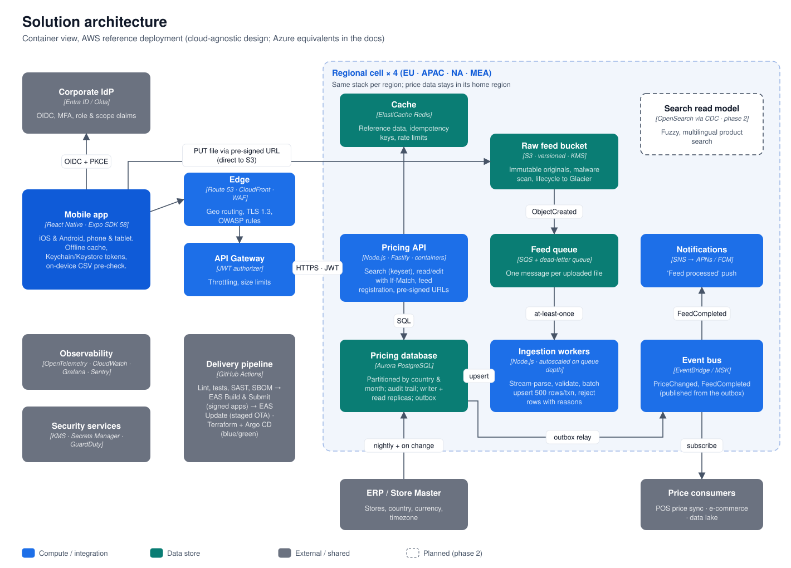

# Retail Pricing Feeds: React Native case study

A **React Native (Expo) mobile app** plus a **Node.js pricing API** that lets a 3,000-store, multi-country retail chain:

- **Upload and persist pricing feeds**: CSV files with `Store ID, SKU, Product Name, Price, Date`.
- **Search pricing records** by product, SKU, store, country, price range and date, then **edit and save** them with conflict protection and a full audit trail.

The brief asked for a single-page web app. This solution targets **iOS and Android (phone and tablet)** instead, because the people who own store prices work on the shop floor, not at desks. The same code also runs on the web through react-native-web.

## Deliverables

| # | Deliverable | Where |
|---|---|---|
| 1 | Context diagram | [docs/01-context.md](docs/01-context.md) |
| 2 | Solution architecture (container view, mobile architecture, key flows, data model, API) | [docs/02-solution-architecture.md](docs/02-solution-architecture.md) |
| 3 | Design decisions (ADR-style, with alternatives and trade-offs) | [docs/03-design-decisions.md](docs/03-design-decisions.md) |
| 4 | Non-functional requirements and how the design addresses them | [docs/04-non-functional-requirements.md](docs/04-non-functional-requirements.md) |
| 5 | Assumptions (including what the runnable version simplifies) | [docs/05-assumptions.md](docs/05-assumptions.md) |
| 6 | Source code | [`mobile/`](mobile) (React Native) and [`backend/`](backend) (API and ingestion) |



## What's in the app

| Screen | What it does |
|---|---|
| **Sign-in** | Corporate SSO in release builds. The demo build offers personas with different data scopes: store manager, country analyst, HQ admin. |
| **Prices** | Debounced search by product name or SKU. Filter sheet for country, store, effective date and price range, plus sort. Infinite list with keyset paging, pull to refresh, offline cache. |
| **Price record** | Price in the store's currency, lineage (feed or manual edit), version. **Edit** with validation, a large-change warning and a mandatory reason. **Conflict handling** if someone else saved first. **Change history.** |
| **Upload** | Pick a CSV from Files or Drive, or use a generated sample feed. **On-device pre-check** (columns, likely-bad rows, preview), then upload with progress and cancel. Duplicate files are recognised. |
| **Feeds** | Upload history with live status, counts (new, changed, unchanged, rejected) and every rejected row with its reasons. |
| **Account** | User, role, stores in scope, API endpoint, sign out (wipes the cache). |

## Run it locally

**Prerequisites:** Node.js **22.13+** for the mobile app (Expo SDK 58; Node 20.19+ is enough for the backend). Xcode with an iOS Simulator and/or Android Studio with an emulator, or Expo Go on a phone on the same network. **No Docker or database install is needed**: the API runs on PGlite, an embedded PostgreSQL.

```bash
git clone https://github.com/fwinmaclinux/retail-pricing-feeds.git
cd retail-pricing-feeds
```

```bash
# 1. API: http://localhost:4000 (seeds 12 stores in 8 countries and ~1,440 prices through the real ingestion path)
cd backend
npm install
npm run dev
```

```bash
# 2. Mobile app: press i (iOS Simulator), a (Android emulator) or w (web), or scan the QR code with Expo Go
cd mobile
npm install
npx expo start
```

The app finds the API on the same host that serves the JS bundle (port 4000). To point it elsewhere, set `EXPO_PUBLIC_API_URL`. To use a real PostgreSQL instead of PGlite, set `DATABASE_URL=postgres://…` for the backend.

### Android APK (demo build)

Install `pricing-feeds-demo.apk` (from the repository's GitHub release, or build it yourself, below) with `adb install pricing-feeds-demo.apk` or by opening it on the device. On the sign-in screen, tap **Server → Change** to point the app at your API:

- Android emulator: `http://10.0.2.2:4000` (the default)
- Phone on the same Wi-Fi: `http://<your computer's IP>:4000`

To build the APK locally (JDK 17 + Android SDK, no Expo account):

```bash
cd mobile
npx expo prebuild --platform android
cd android
./gradlew assembleRelease
```

The output is `mobile/android/app/build/outputs/apk/release/app-release.apk`. With an Expo account, `npx eas-cli build -p android --profile preview` builds the same APK in the cloud (see `mobile/eas.json`).

The demo APK is signed with the debug keystore and allows plain HTTP so it can reach a local API. Store builds go through EAS with a managed keystore and HTTPS only.

### Demo script

1. Sign in as **Amelia Clarke** (Store Manager, London). Search shows only London Oxford Street prices.
2. **Upload → Use a sample feed**. The pre-check flags 2 rows (comma decimal, `DD/MM/YYYY` date). Upload anyway, then watch the feed finish as *Completed with errors*: 10 rows loaded, 2 rejected with reasons.
3. Upload the same sample again. It is recognised as a duplicate and not re-applied.
4. **Prices →** open a record **→ Edit**, change the price and give a reason **→ Save**. The change history shows old → new, who and why.
5. To see **conflict handling**, open the same record on two devices (or change it with `curl` while it's open) and save the older copy. The app shows who changed it and offers *Use latest* or *Keep my changes*.
6. Sign out and sign in as **Priya Nair** (Pricing Analyst, India). Results and filters are now scoped to the three Indian stores, in INR.

More files to try are in [`sample-data/`](sample-data): a valid London delta, a Mumbai file mixing valid rows with five common mistakes, and a 25,000-row full feed for throughput. Regenerate them with `npm run generate:feeds` in `backend/`.

## Tests

```bash
cd backend
npm test
npm run typecheck
```

30 tests: CSV contract rules, plus API integration tests on real PostgreSQL (PGlite) covering upload and ingestion, row-level rejects, duplicates, idempotent re-loads, scope enforcement, filters, keyset paging, `If-Match` edits, `412` conflicts and audit history.

```bash
cd mobile
npm test
npm run typecheck
```

13 tests: on-device CSV pre-check, sample feed and edit validation rules.

## Repository layout

```
backend/                  Node.js 22 · Fastify · TypeScript · zod · csv-parse
  src/feeds/              upload registration, streaming ingestion, CSV contract, job queue
  src/prices/             scoped keyset search, If-Match edits, audit history
  src/auth/               JWT auth, roles, row-level scope (demo personas in dev)
  src/db/                 PostgreSQL/PGlite adapter, versioned migrations, seed data
  test/                   vitest unit + API integration tests
mobile/                   React Native 0.88 · Expo SDK 58 · Expo Router · TanStack Query · FlashList
  src/app/                screens (file-based routes, auth-guarded)
  src/features/           prices / feeds feature modules (hooks, components, pure logic + tests)
  src/api/                typed API client, problem-details errors, upload with progress
  src/auth/  src/query/   secure session, persisted offline cache
docs/                     deliverables + diagrams (generated from docs/diagrams/build-diagrams.mjs)
sample-data/              example CSV feeds
```

## From demo to production

The runnable version keeps the production contracts and swaps the infrastructure for local stand-ins: personas instead of the IdP, a local PUT instead of S3 pre-signed URLs, an in-process queue instead of SQS, PGlite instead of Aurora, and polling instead of push. The full mapping is in [docs/05-assumptions.md](docs/05-assumptions.md#simplifications-in-the-runnable-implementation). Next steps would be EAS build profiles and an OIDC client (`expo-auth-session`), Terraform for one regional cell, a Maestro E2E suite in CI, and Sentry and OpenTelemetry wiring.
