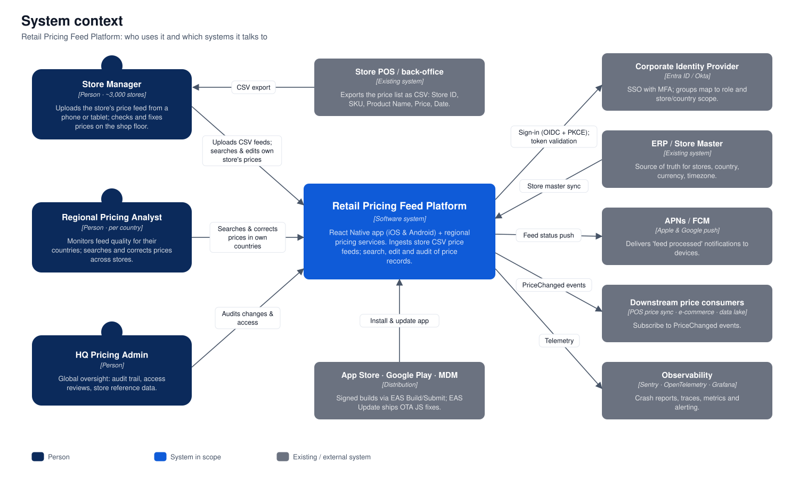

# 1. Context

## Problem

A retail chain with **3,000 stores in several countries** needs one way to:

1. **Upload and persist pricing feeds**: CSV files from store systems with `Store ID, SKU, Product Name, Price, Date`.
2. **Search pricing records** using different criteria, then **edit and save** any record the user is allowed to change.

The case study asks for a single-page web app. This solution delivers a **React Native mobile app (iOS and Android, phone and tablet)** instead. The people who own store prices (store managers and regional pricing analysts) work on the shop floor, in back offices and on the move, not at desks. A mobile app gives them:

- Upload straight from the device: the Files app, OneDrive/Google Drive, or an email attachment.
- Price checks at the shelf: search a SKU, see the price in effect, fix it on the spot.
- Push notifications when a feed has been processed, plus offline access to recent results in stores with poor connectivity.

## Actors

| Actor | Volume (assumed) | Needs |
|---|---|---|
| **Store Manager** | ~3,000 (one or more per store) | Upload the store's feed, see which rows were rejected and why, search and correct prices **for their own store only**. |
| **Regional Pricing Analyst** | ~150 | Monitor feed quality for **their countries**, search across stores, correct prices, review the change history. |
| **HQ Pricing Admin** | ~20 | Global view, audit, access reviews, reference data. |

## External systems

| System | Interaction |
|---|---|
| **Store POS / back-office** | Produces the CSV export that users upload. The app does not integrate with it directly. |
| **Corporate Identity Provider** (Entra ID / Okta) | Single sign-on with MFA (OIDC Authorization Code + PKCE). Group membership maps to role and store/country scope. |
| **ERP / Store Master** | Source of truth for stores and their country, currency and timezone. Synced nightly and on change. **Currency is never taken from the uploaded file.** |
| **APNs / FCM** | Push notifications such as "Your feed for GB-LON-001 has been processed, 3 rows rejected". |
| **Downstream price consumers** | POS price sync, e-commerce and the data lake subscribe to `PriceChanged` events. This platform does not push prices to tills itself. |
| **App Store / Google Play / MDM** | Distribution of signed builds (EAS Build/Submit). Corporate devices are enrolled in MDM (e.g. Intune). JS-only fixes ship as staged OTA updates (EAS Update). |
| **Observability** | Sentry for mobile crashes and performance; OpenTelemetry traces, metrics and logs for the backend. |
