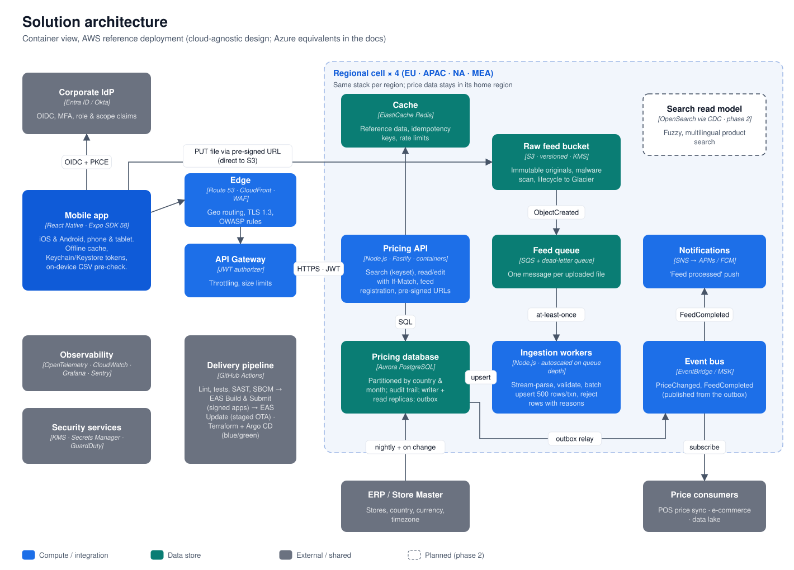
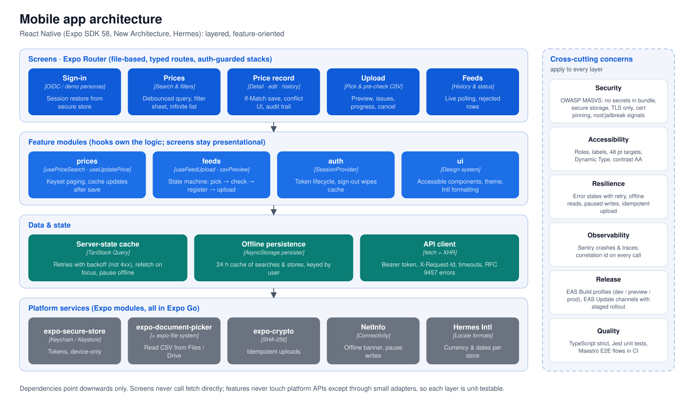
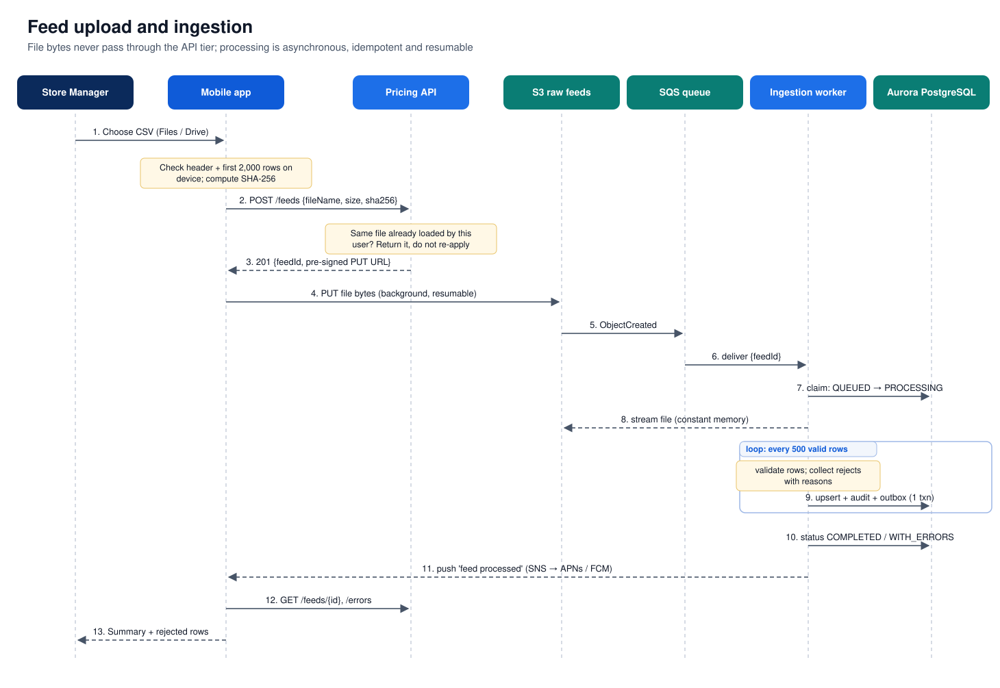
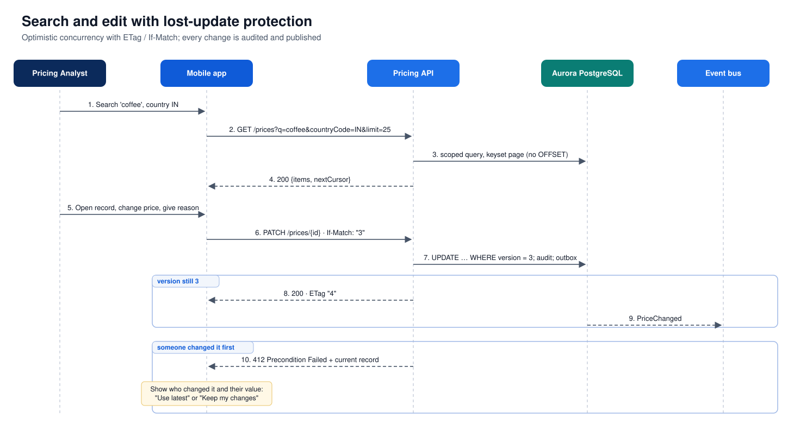

# 2. Solution architecture

## 2.1 Container view

The platform is deployed as **identical regional cells** (EU, APAC, NA, MEA). A user's token carries their home region, and the app talks only to that region's endpoint. Price data never leaves its region (data residency), and an incident in one region cannot take down the others (blast radius).

| Container | Technology (AWS reference) | Responsibility |
|---|---|---|
| **Mobile app** | React Native 0.88, Expo SDK 58, TypeScript, Hermes, New Architecture | Upload with on-device pre-check, search, edit, history, feed status. Offline read cache; tokens in Keychain/Keystore. |
| **Edge** | Route 53 (geo/latency), CloudFront, AWS WAF | TLS 1.3, OWASP managed rules, bot and rate protection, routing to the home region. |
| **API Gateway** | API Gateway with JWT authorizer | Validates IdP tokens, per-user throttling, request size limits. |
| **Pricing API** | Node.js 22, Fastify, containers on ECS Fargate / EKS | Search (keyset pagination), read and edit with `If-Match`, feed registration, pre-signed upload URLs, audit. Stateless and horizontally scaled. |
| **Raw feed bucket** | S3: versioned, SSE-KMS, Object Lock, lifecycle to Glacier | Immutable original files (evidence and replay). Malware scan on arrival. |
| **Feed queue** | SQS with dead-letter queue | One message per uploaded file; at-least-once delivery; redrive after 5 failures. |
| **Ingestion workers** | Same Node.js codebase, separate deployment, autoscaled on queue depth | Stream-parse, validate, batch upsert, record rejected rows, publish events. |
| **Pricing database** | Aurora PostgreSQL: writer plus read replicas | System of record. `price_record` partitioned by country and month. Append-only audit table. Transactional outbox. |
| **Cache** | ElastiCache Redis | Store reference data, idempotency keys, distributed rate limits. |
| **Event bus** | EventBridge (or MSK/Kafka where the enterprise standard requires it) | `PriceChanged` and `FeedCompleted`, relayed from the outbox. |
| **Notifications** | SNS mobile push → APNs / FCM | "Feed processed" notification to the uploader's devices. |
| **Search read model** *(phase 2)* | OpenSearch fed by CDC from Aurora | Fuzzy and multilingual product search, if PostgreSQL trigram search stops being enough. |

### Azure equivalents (cloud-agnostic design)

| AWS | Azure |
|---|---|
| Route 53 + CloudFront + WAF | Azure Front Door + WAF |
| API Gateway | API Management |
| ECS / EKS | Azure Container Apps / AKS |
| S3 | Blob Storage (immutable policies) |
| SQS | Service Bus queues |
| Aurora PostgreSQL | Azure Database for PostgreSQL Flexible Server (Citus for horizontal scale) |
| ElastiCache | Azure Cache for Redis |
| EventBridge / MSK | Event Grid / Event Hubs |
| SNS mobile push | Notification Hubs |
| KMS / Secrets Manager | Key Vault |
| CloudWatch / X-Ray | Azure Monitor / Application Insights |
| GuardDuty Malware Protection for S3 | Defender for Storage |

## 2.2 Mobile app architecture

- **Screens** (`src/app`, Expo Router): file-based routes with typed links. `Stack.Protected` guards keep signed-out users on the sign-in screen and signed-in users out of it.
- **Feature modules** (`src/features/*`): hooks hold the logic and screens stay presentational. Examples are `usePriceSearch` (infinite keyset pages), `useUpdatePrice` (`If-Match` save and cache update) and `useFeedUpload` (an explicit state machine: *pick → pre-check → register → upload → hand-off*).
- **Data and state**: TanStack Query owns all server state: caching, retries with backoff (never for 4xx), refetch on foreground, and pausing writes while offline. The cache is persisted to device storage for 24 h. Every query key starts with the user id, so cached data cannot leak between users on a shared device. There is no Redux: almost all state here is server state.
- **API client** (`src/api`): typed endpoints, bearer token, `X-Request-Id` correlation id on every call, timeouts, and RFC 9457 problem details mapped to `ApiError`. Uploads use `XMLHttpRequest` because `fetch` exposes no upload progress in React Native.
- **Platform services**: `expo-secure-store` (tokens), `expo-document-picker` and `expo-file-system` (CSV), `expo-crypto` (SHA-256), NetInfo (connectivity), Hermes `Intl` (currency and date formatting per store).

## 2.3 Key flows

### Upload and ingestion

1. The app parses the header and up to 2,000 rows **on the device** and shows missing columns and likely-bad rows before anything is sent. This is fast feedback only; the server re-validates everything.
2. `POST /api/v1/feeds` registers the upload with the file's SHA-256. If the same user already uploaded the same content, the API returns the existing feed and nothing is applied twice.
3. The app `PUT`s the bytes **directly to S3** with a short-lived pre-signed URL. Large files use multipart upload in a native background session, so the transfer survives the app being backgrounded.
4. `ObjectCreated` → SQS → a worker claims the feed (`QUEUED → PROCESSING`) and **streams** the file with constant memory.
5. Each row is validated. Valid rows are upserted in batches of 500, each batch in one transaction together with its audit rows and outbox events. Invalid rows are stored with their line number and reasons.
6. The feed ends as `COMPLETED`, `COMPLETED_WITH_ERRORS` or `FAILED` (bad header or no data rows). A push notification is sent, and the app shows counts (new, changed, unchanged, rejected) plus the rejected rows.

### Search and edit

- **Search** combines free text (SKU prefix, or product name via a `pg_trgm` index) with store, country, price range and effective-date range, and sorts by date, price or SKU. Every query gets the caller's **row-level scope** (own store, own countries, or all) appended on the server. A filter sent by the client can never widen it.
- Paging is **keyset (cursor) based**. Page 500 costs the same as page 1, and inserts happening during a scroll cause no duplicates or gaps.
- **Edit** sends `If-Match: "<version>"`. If anyone (a feed or a colleague) changed the record since it was opened, the API answers **412** with the current record. The app then shows who changed it and to what, and lets the user choose **Use latest** or **Keep my changes**. Every save needs a reason and is written to the audit trail in the same transaction.

## 2.4 Data model (core tables)

| Table | Key columns | Notes |
|---|---|---|
| `store` | `store_id` PK, `country_code`, `currency`, `timezone`, `region` | Synced from ERP. Drives currency and data scoping. |
| `price_feed` | `feed_id` PK, `uploaded_by`, `checksum_sha256`, `status`, row counters | Unique `(uploaded_by, checksum)` index for idempotent uploads. |
| `price_feed_error` | `(feed_id, row_number)` PK, `raw_row`, `messages` | Capped at 1,000 stored rows per feed; all rejections are counted. |
| `price_record` | `id` PK, **unique `(store_id, sku, effective_date)`**, `price NUMERIC(14,4)`, `currency`, `version` | Production: `PARTITION BY LIST (country_code)`, then `RANGE (effective_date)` monthly. Indexes per access path, plus a trigram GIN index on `product_name`. |
| `price_record_audit` | `audit_id` PK, `price_record_id`, `action`, `old_values`, `new_values`, `changed_by`, `change_reason` | Append-only. `CREATED`, `FEED_UPDATE`, `MANUAL_EDIT`. |

## 2.5 API (v1)

| Method & path | Purpose |
|---|---|
| `POST /api/v1/feeds` | Register an upload `{fileName, sizeBytes, checksumSha256}` and get the upload URL (or the existing duplicate). |
| `PUT  /api/v1/feeds/{id}/content` | Local stand-in for the S3 pre-signed PUT (streamed to storage, checksum verified). |
| `GET  /api/v1/feeds` · `/{id}` · `/{id}/errors` | Upload history, live status and counters, rejected rows with reasons. |
| `GET  /api/v1/prices?q&storeId&sku&countryCode&minPrice&maxPrice&dateFrom&dateTo&sort&order&limit&cursor` | Scoped, keyset-paginated search. |
| `GET  /api/v1/prices/{id}` | Record with `ETag: "<version>"`. |
| `PATCH /api/v1/prices/{id}` | Edit `{price?, productName?, reason}` with `If-Match`. Returns `412` + current record on conflict, `428` without `If-Match`. |
| `GET  /api/v1/prices/{id}/history` | Audit trail. |
| `GET  /api/v1/stores`, `GET /api/v1/me` | Scoped reference data and the caller's identity. |
| `GET  /health/live`, `/health/ready` | Liveness and readiness probes. |

Errors use RFC 9457 problem details (`application/problem+json`) with a `code`, a human-readable `title`, field-level `errors` and the `requestId`.
